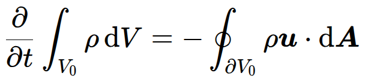

# openclaw-skills

Reusable agent skills and the scripts they call.

| Skill | What it does |
|---|---|
| [`math-typeset-chat`](math-typeset-chat/SKILL.md) | Chat clients print raw LaTeX, so render formulas as images: one tight PNG strip per display equation, plus an optional book-style A4 page for long derivations. |

## math-typeset-chat

Two shapes, both typeset with KaTeX in Computer Modern and rasterized through headless Chrome.

- **Strip mode** (default): every display equation becomes its own tightly cropped PNG, meant to sit directly under a copyable `text` code block holding the same formula.
- **Page mode**: a multi-step derivation becomes one A4 page — serif CJK body, right-aligned equation numbers, PDF plus 200 dpi PNG.



### Requirements

- Node.js 18+
- Google Chrome or Chromium (`CHROME_BIN` overrides the path)
- Python 3 with Pillow (autocrop step)
- `pdftoppm` from poppler-utils (page mode)
- KaTeX, installed once in a scratch dir:

```bash
mkdir -p ~/tools/katex && cd ~/tools/katex && npm init -y >/dev/null && npm install katex@0.16.9
export KATEX_DIST=~/tools/katex/node_modules/katex/dist
```

### Install the skill

```bash
cp -r math-typeset-chat ~/.openclaw/agents/<agent>/agent/workshop-skills/
mkdir -p ~/.openclaw/workspace/<agent>/tools
cp scripts/*.mjs ~/.openclaw/workspace/<agent>/tools/
```

### Usage

```bash
# one PNG per display equation -> strips/eq-01.png ...
node scripts/eqstrip.mjs examples/eqs.md --outdir strips --prefix eq

# whole derivation -> page.html / page.pdf / page.png
node scripts/texpage.mjs examples/eqs.md --dpi 200
```

Options: `eqstrip.mjs` accepts `--size 24` (math size), `--bg white|transparent`, `--prefix`, `--outdir`;
`texpage.mjs` accepts `--dpi`, `--out`. Environment: `KATEX_DIST`, `KATEX_ROOT`, `CHROME_BIN`.

### Notes

- Strips default to a white background on purpose: transparent glyphs are black and vanish in dark chat themes.
- Page mode fits one A4 page at 10 pt body / 1.74 line-height / 18-18-12-18 mm margins. Check `pdfinfo page.pdf | grep Pages` — only page 1 becomes the PNG.
- A display equation must close its `$$`, otherwise the following text is parsed as part of the formula and KaTeX prints it as red error output.

## 中文说明

聊天窗口（OpenClaw WebChat / Control UI）不渲染 LaTeX，`$...$` 会原样显示。这个 skill 把公式排版成图片：

- **公式条**：每个公式一张紧贴字形的 PNG，放在可复制的 code 框下面；
- **整页模式**：成串推导出一张 A4 书页（宋体正文、公式编号右对齐、PDF + PNG）。

排版用 KaTeX（Computer Modern），出图用无头 Chrome。依赖与安装见上文。
